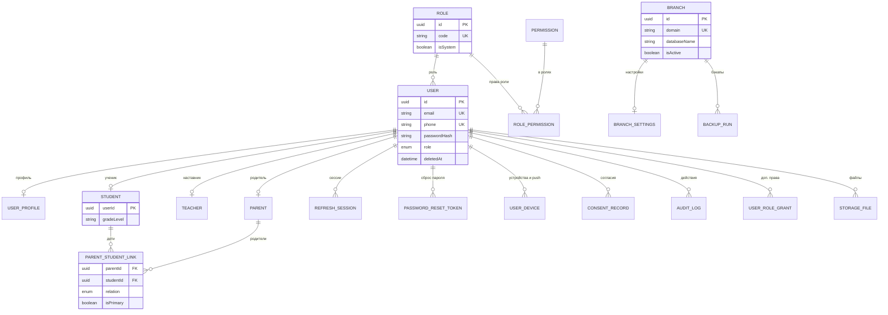
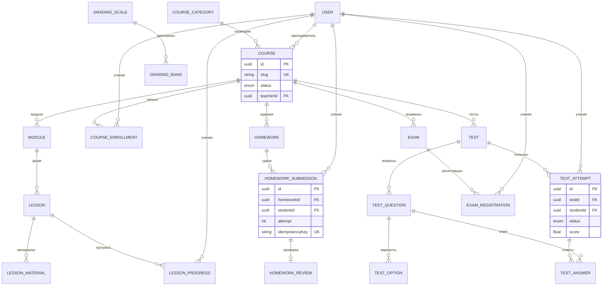
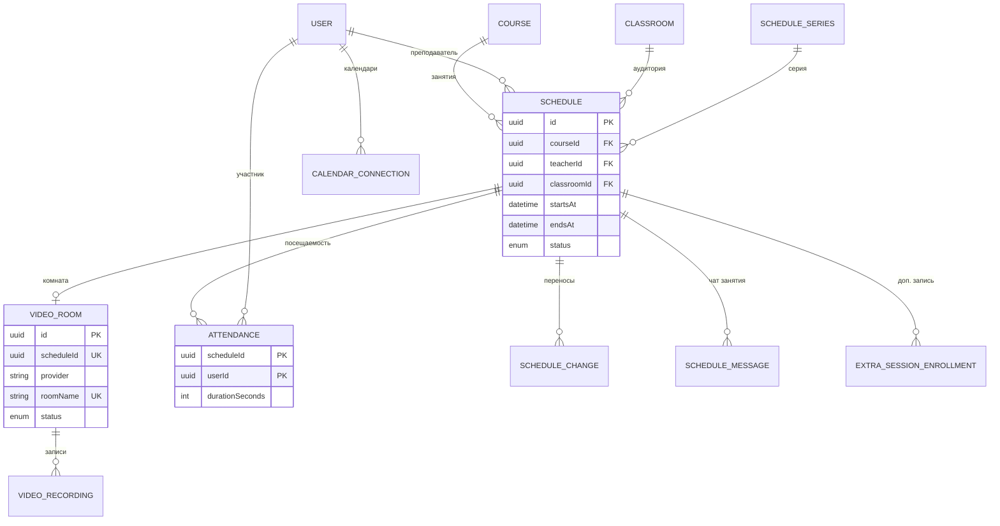

# ER-диаграмма

Диаграмма отражает связи доменов, а не полный список полей: поля и ограничения
описаны в [`schema.md`](schema.md), актуальная схема — `apps/api/prisma/schema.prisma`
(128 моделей, 64 enum на 20.11.2026).

Обозначения Mermaid: `||--o{` — один ко многим, `||--o|` — один к нулю или одному,
`}o--o{` — многие ко многим через связующую таблицу.

## 1. Identity, доступ и филиалы

Филиал — граница данных: у каждого филиала своя база, поэтому `Branch` живёт в
управляющей БД и не имеет внешних ключей на доменные таблицы.

## 2. Обучение и аттестация

## 3. Расписание, аудитории и видео

Конфликты занятий проверяются по `(teacherId, startsAt)`, `(courseId, startsAt)`
и `classroomId`: пересечение интервалов `startsAt`/`endsAt` не допускается.

## 4. Экономика, коммуникации и интеграции

```mermaid
erDiagram
  USER ||--o| COIN_BALANCE : "баланс"
  USER ||--o{ COIN_TRANSACTION : "история монет"
  USER ||--o{ USER_COIN_PROFILE : "уровень"
  COIN_LEVEL ||--o{ USER_COIN_PROFILE : "уровень"
  USER ||--o{ COIN_APPEAL : "апелляции"
  SHOP_PRODUCT ||--o{ SHOP_ORDER : "заказы"
  USER ||--o{ SHOP_ORDER : "покупатель"
  ACHIEVEMENT ||--o{ USER_ACHIEVEMENT : "выдачи"
  USER ||--o{ USER_ACHIEVEMENT : "получатель"
  CONVERSATION ||--o{ CONVERSATION_PARTICIPANT : "участники"
  USER ||--o{ CONVERSATION_PARTICIPANT : "участие"
  CONVERSATION ||--o{ MESSAGE : "сообщения"
  USER ||--o{ MESSAGE : "автор"
  USER ||--o{ NOTIFICATION : "уведомления"
  USER ||--o{ NOTIFICATION_PREFERENCE : "настройки каналов"
  USER ||--o{ SUPPORT_TICKET : "обращения"
  USER ||--o{ AI_REQUEST : "AI-запросы"
  COMMUNITY_EVENT ||--o{ EVENT_REGISTRATION : "участники"
  COMMUNITY_EVENT ||--o{ EVENT_RESULT : "результаты"

  COIN_TRANSACTION {
    uuid id PK
    uuid userId FK
    int amount
    enum sourceType
    string sourceId
  }
  SHOP_ORDER {
    uuid id PK
    uuid productId FK
    uuid userId FK
    enum status
  }
  INTEGRATION_CONFIG {
    uuid id PK
    string provider UK
    boolean enabled
  }
  INTEGRATION_EVENT {
    uuid id PK
    string provider
    enum status
    string message
  }
  SUPPORT_TICKET {
    uuid id PK
    uuid requesterId FK
    enum status
    enum priority
  }
```

`IntegrationConfig`/`IntegrationEvent` намеренно не связаны внешним ключом:
журнал интеграций хранит провайдера строкой и переживает удаление настройки.
Секреты интеграций в БД не хранятся — только имена переменных окружения.

## Связь с изоляцией филиалов

1. Каждая доменная таблица находится в БД своего филиала; сквозных FK между
   филиалами нет.
2. `Branch` и `BackupRun` живут в управляющей БД и не читают доменные данные.
3. Все запросы выполняются через Prisma-клиент, созданный для БД филиала из
   `Host`; `branchId` из тела запроса игнорируется.
4. Realtime-комнаты включают `branchId`, поэтому подписка на чужую комнату
   невозможна даже при валидном токене другого филиала.
